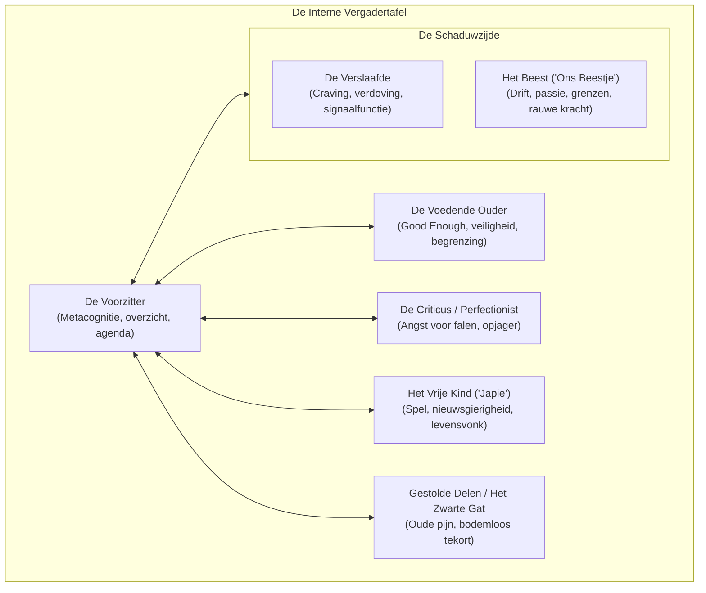

# De interne vergadertafel en het ontwikkelen van een voedende ouder

> **Theoretisch fundament en praktijkgids voor de interne dialoog**  
> *Over het multimind-brein, egostates, gestolde ontwikkeling en hoe we van een chaotische binnenwereld een constructief overleg maken.*

---

## Inleiding: hinken op twee gedachten

We kennen allemaal het gezegde: *hinken op twee gedachten*. Ik neem me stellig voor om iets te gaan doen - en voor ik het weet doe ik precies het tegenovergestelde. 

Dat kan gaan over ogenschijnlijk alledaagse zaken die plotseling loodzwaar worden:
* Wel of niet vandaag die administratie of die rommel opruimen;
* Wel of niet nu eindelijk beginnen aan dat lastige project;
* Wel of niet iemand vandaag open en eerlijk de waarheid zeggen.

Het zijn twee gedachten die haaks op elkaar staan. Zodra de ene stem zijn zin krijgt, blijft de andere gefrustreerd achter. In de volksmond noemen we dat vaak het conflict tussen 'verstand' en 'gevoel'. We kunnen een situatie met ons gezonde verstand glashelder analyseren, terwijl ons emotionele lijf heel iets anders schreeuwt. En die verschillende manieren van weten zijn het zelden zomaar met elkaar eens.

Kijk maar naar je eigen dagelijkse leven. Onze vermogens en reacties wisselen voortdurend met de rollen die we aannemen. Onze zorgvuldig opgebouwde volwassenheid kan binnen dertig seconden als sneeuw voor de zon verdwijnen zodra we over de drempel stappen bij onze ouders. De ordelijkheid, daadkracht en kalmte die we op ons werk laten zien, kan binnenshuis omslaan in stuurloze chaos. 

Of heb je wel eens meegemaakt dat je je tijdens kantooruren heilig voornam om een belangrijk privé-telefoontje te plegen, en dat je daar pas om vijf over vijf weer aan dacht - precies op het moment dat de bank net gesloten is? De privé-mindset (*de ik-voor-mijn-eigen-zaken*) moest wijken voor de werk-mindset (*de ik-op-mijn-werk*). Blijkbaar gaat er een schuifje om zodra we door de kantoordeur stappen, en floept het pas weer aan als de werkdag erop zit.

We zien dit ook bij mensen die van omgeving wisselen. Een vriend of collega die op de ene werkplek als de sullige meeloper gold, bloeit op een nieuwe plek waar hij gewaardeerd wordt ineens op tot een creatieve pionier met een flair die niemand achter hem had gezocht. 

Dat brengt ons bij een fundamentele vraag: wie zijn we eigenlijk wanneer we 'ik' zeggen?

---

## Multimind: het brein als zwerm en mierenhoop

Om dit verschijnsel te begrijpen, moeten we het negentiende-eeuwse idee van het 'monolithische Ik' loslaten. Het model van waaruit ik werk stoelt onder meer op het *multimind*-concept van neuroloog Robert Ornstein. 

De moderne neurowetenschap laat zien dat ons brein niet één centrale bestuurder heeft, maar is opgebouwd uit een ontzagwekkende hoeveelheid kleine, gespecialiseerde modules. De ene module is steengoed in het herkennen van gezichtsuitdrukkingen, de ander in het scannen van gevaar, het voelen van een specifieke emotie, het horen van melodie of het construeren van een logisch betoog. Ons functioneren is het resultaat van de manier waarop al die afzonderlijke modules op elkaar zijn afgestemd.

Filosoof Daniel Dennett gebruikt hiervoor de prachtige metafoor van de bijenkorf (*beehive*) of de mierenhoop. Een individuele bij op zichzelf is niet bijster intelligent. Zij ruikt een bloem met nectar, vliegt eropaf en vindt de weg terug naar de korf. En dan komt het cruciale: zij beheerst het dansje waarmee zij haar zusters exact vertelt waar de honing te halen valt. 

Er is constante informatie-overdracht. Andere bijen verzorgen de larven, bouwen raten of verdedigen de ingang. Niet één individuele bij heeft de blauwdruk van het geheel in haar kop. Juist door de wisselwerking en de gespecialiseerde diversiteit ontstaat de intelligente architectuur van het volk. De bijenkorf als geheel is vele malen slimmer dan het individuele bijtje. 

In ons menselijk brein werkt dat precies zo. Onze neurologische modules kunnen in wisselende clusters worden geactiveerd. De patronen die daardoor ontstaan noemen we *mind-sets*, *rollen*, of in therapeutische termen: *egostates*.

Mensen met een audiosysteem kennen de equalizer: hetzelfde muziekstuk klinkt volstrekt anders wanneer je overschakelt van de instelling 'classic' naar 'rock' of 'heavy bass'. Of denk aan een computer: exact hetzelfde apparaat vertoont radicaal ander gedrag wanneer je tekstverwerker op de voorgrond draait dan wanneer je een grafisch ontwerpprogramma opent. 

Onze verschillende 'ik-jes' zijn niets anders dan dergelijke actieve configuraties.

---

## Wat is een 'ik' eigenlijk?

Als ik vanavond aan de toog zeg: *"Ik neem vanavond écht maar één enkel pilsje"*, en ik hoor mezelf de volgende ochtend met bonkende hoofdpijn zuchten: *"Ik baal er zó van dat ik weer te zwak was om me aan mijn plan te houden"*, wie spreekt er dan eigenlijk?

Ik baal niet van 'mijzelf' als geheel; ik baal vanuit de ene mindset van de acties van een ándere mindset.

In mijn werk zie ik het menselijk **Zelf** primair als het biologische, emotionele en somatische draagvlak. Het **Ik** is daarentegen een dynamisch verhaal dat ons centrale frontale brein construeert om richting te geven aan ons handelen. Het frontale brein formuleert zelfbeelden en wereldbeelden, en stuurt op basis daarvan ons gedrag aan. Maar omdat verschillende modules verschillende behoeften en herinneringen vertegenwoordigen, hebben de meeste mensen een heel gezelschap aan 'ikjes' aan boord.

Dat is geen pathologie. Sigmund Freud sprak al over de *situationele neurose*: iemand functioneert in het dagelijks leven uitstekend, totdat een specifieke context een oude afweer triggert waardoor hij plotseling regresseert. In posttraumatische stress (PTSS) zien we dit in extreme vorm: een knal van een uitlaat op straat activeert onmiddellijk het overlevingsnetwerk van een veteraan, waardoor het hele zenuwstelsel binnen een milliseconde in de vecht- of vluchtstand van het slagveld schiet. De tijdsdimensie klapt in: het 'toen' wordt direct beleefd als 'nu'.

Mij wordt wel eens gevraagd of het 'onbewuste' niet een onbewezen construct is binnen de psychologie. Mijn antwoord is steevast: ik denk dat het zogeheten ondeelbare 'bewustzijn' een veel twijfelachtiger fictie is.

---

## Het ongekerfde blok en de barsten in het hout

Een beeld dat ik vaak gebruik om deze dynamiek visueel te maken, is een schijf hout die dwars uit een boomstam is gezaagd. Je ziet de jaarringen van de levensloop, van de prille kern tot de buitenste schors. 

Wanneer zo'n verse schijf hout in weer en wind blijft liggen zonder verzorging, begint het hout langzaam uit te drogen. Wat begon als microscopische haarscheurtjes aan de rand, trekt beetje bij beetje door naar het centrum. Wordt het hout tijdig gevoed en behandeld, dan blijft de samenhang bewaard. Maar laat je het hout aan zijn lot over, dan scheuren de kerven zo diep in dat er losse taartpunten ontstaan - een uiteengevallen puzzel waarin de delen elkaar niet meer raken.

Dit is een treffende metafoor voor de menselijke psyche:
* Hoe diep lopen de kerven bij jou naar binnen?
* Waar is het contact tussen de verschillende delen verbroken?
* Is er nog onderling overleg mogelijk, of zijn de taartpunten losgeslagen eenheden geworden die elkaar bevechten om het stuur?

---

## De metafoor van de interne vergadertafel

Om uit de kramp van innerlijke zelfveroordeling te stappen, nodig ik cliënten uit om zichzelf voor te stellen als een wandelende, ovale vergadertafel. Sommige thema's passeren de tafel zonder ophef; andere onderwerpen worden midden op tafel gegooid en ontketenen een verhit debat.

Rondom die tafel zitten onze verschillende deelpersoonlijkheden.

Het woord *persoon* stamt af van het Latijnse *per-sonare*: "dat wat er doorheen klinkt". In het antieke theater droegen de acteurs grote maskers om hun rol uit te beelden. Toch herkende het publiek de specifieke stem en eigenheid van de acteur achter het masker: dat wat erdoorheen klonk. Onze rollen en mindsets zijn dergelijke maskers, maar de kern die erdoorheen klinkt, zoekt naar verbinding.

Als mensen voor het eerst met dit beeld kennismaken, vragen ze vaak gretig naar een standaardlijstje: *"Wie zitten er dan allemaal aan mijn tafel?"* 

Therapievormen zoals de Transactionele Analyse (TA) hanteren vaste schema's (het Vrije Kind, het Aangepaste Kind, de Kritische Ouder). Hoewel die categorieën vaak uiterst herkenbaar zijn, pas ik ervoor om mensen een blauwdruk op te dringen. Mensen hebben unieke levens geleefd, unieke wonden opgelopen en eigen overlevingsstrategieën ontwikkeld. Het doel van de vergadertafel is niet om een theoretisch model af te vinken, maar om je eigen unieke tafelgenoten te leren kennen en met hen aan de praat te raken.

Toch zijn er archetypische stoelen die we bij vrijwel iedereen aan tafel zien aanschuiven. Laten we die eens verkennen.

---

## Wie zitten er zoal aan tafel?

### 1. De perfectionist, de eeuwige criticus en de opjager

Bijna iedereen heeft aan zijn vergadertafel wel een hyperkritische stem zitten. Bij sommigen is deze criticus verheven tot een duistere kunstvorm: wat je ook presteert, hoe hard je ook werkt en hoeveel diploma's of complimenten je ook verzamelt, het is *nooit* goed genoeg. Er is altijd wel een detail dat beter had gemoeten.

Vaak draagt deze figuur de gelaatstrekken van een vroegere opvoeder, leraar of strenge omgeving. Deze stem ondermijnt het plezier in werken en leven fundamenteel. De motivatie verschuift van nieuwsgierigheid naar angstvermijding: krampachtig proberen geen fouten te maken.

Als je psychologisch wat dieper kijkt, ontdek je dat perfectionisme in wezen een **zeer kinderlijke gedachte** is. De overtuiging dat iets in deze imperfecte, rauwe wereld 'perfect' zou kunnen zijn, getuigt van een magisch kinderbrein. Het is een primitieve overlevingsstrategie van een kind dat wanhopig probeert verwerping of straf voor te zijn door foutloos te marcheren. Het verraadt dat er in de vroege opvoeding te weinig ruimte was voor barmhartigheid en vergevingsgezindheid. 

De criticus jaagt op, straft af en controleert, maar hij kan één ding fundamenteel niet: werkelijke bedding en troost bieden.

### 2. Kinderlijk plezier: het vrije kind (mijn "Japie")

Aan de andere kant van het spectrum vinden we het vermogen tot onbevangen vreugde, speelsheid, ondeugd en de meest vitale emotie van ons zenuwstelsel: nieuwsgierigheid. 

In de Transactionele Analyse heet dit het 'Vrije Kind'. Zelf werk ik liever met persoonlijke namen. Als een cliënt spreekt over "mijn kleine Japie die met een houten zwaard door de struiken struint" of "mijn Floor die onbedaarlijk kan giechelen", dan heeft dat oneindig veel meer emotionele zeggingskracht dan een klinische term.

De keerzijde van deze stoel is helder: het kind aan tafel draagt onze levenslust, maar daarmee ook onze diepste kwetsbaarheid. Zodra de sfeer grimmig wordt of er afwijzing dreigt, krimpt dit deel ineen.

### 3. Angst en aanpassing: het aangepaste kind

Wanneer de omgeving vroeger onveilig, grillig of veeleisend was, leert een kind razendsnel om te scannen op de behoeften van de volwassenen. Dit deel aan tafel voelt zich plotseling weer heel klein worden wanneer iemand met stemverheffing spreekt, de wenkbrauwen fronst of wanneer de interne criticus begint te donderpreken.

Het aangepaste kind zoekt veiligheid door onzichtbaar te worden, overmatig te pleasen of slaafs de instructies van anderen op te volgen, zelfs ten koste van de eigen grenzen en integriteit.

### 4. Gestolde ontwikkeling en traumasporen

Bij mensen met een pijnlijke of traumatische levensgeschiedenis zit er vaak aan tafel wat ik **gestolde ontwikkeling** noem.

Een kinderleven hoort zich organisch te ontvouwen. We ontdekken de wereld, stoten onze neus, krijgen troost en leren met vallen en opstaan nieuwe vaardigheden. Totdat er op een dag iets gebeurt dat het kinderbrein hopeloos overvraagt. Er is geweld, verwaarlozing, een plotseling verlies of een atmosfeer van chronische dreiging. Het kind heeft de cognitieve en emotionele instrumenten niet in huis om dit op te lossen. Er is niemand die helpt, niemand die het voordoet, niemand die containment biedt.

Op dát moment zie je een stuk van de ontwikkeling letterlijk verstarren. Het stolt.

Wanneer ik met cliënten door oude familiealbums blader, zie je die stolling soms haarscherp terug in de foto's:
* Tot het vijfde jaar een dartel, open kind;
* Rond het zesde jaar plotseling een verharde kaaklijn;
* Een starre, ingehouden oogopslag;
* Een hol getrokken ruggetje of een krampachtig ingetrokken buik.

Die somatische verstarring blijft decennialang bewaard. Het emotionele geheugen werkt als een hologram: zodra een situatie in het hier-en-nu lijkt op de overvraging van toen, wordt de hologram geactiveerd. Ineens zit er geen veertigjarige directeur aan tafel, maar een doodsbang jochie van zes dat zijn kaken op elkaar klemt, of een volwassen vrouw die plotseling met gebogen schouders en piepende stem praat als een weggestopt meisje van acht.

### 5. Het deficiet: het zwarte gat

Naast gestolde gebeurtenissen kennen veel mensen een structureel emotioneel tekort: een bodemloze leegte aan tafel die ik zonder omwegen **het zwarte gat** noem. 

Dit ontstaat wanneer een kind langdurig emotioneel niet gevoed is. Er was geen echte aandacht, geen warmte, geen spiegeling of geen veilige vader- of moederfiguur. Als volwassene lopen we rond met die gapende kinderlijke honger. 

Een cliënte zei me ooit:  
*"Omdat mijn vader emotioneel volkomen afwezig was, bombardeer ik onbewust iedere oudere man tot vaderfiguur - of het nou mijn baas is of een wildvreemde aan de toog. Ik blijf maar bedelen om goedkeuring."*

En een mannelijke cliënt verwoordde het raak:  
*"Omdat mijn moeder me nooit echt zag, ben ik een chronische aandachtsjunkie geworden. Zodra een vrouw naar me glimlacht, móét ik haar behagen."*

Het zwarte gat schreeuwt om opvulling. En als er iemand voorbijkomt die aan die behoefte lijkt te voldoen, voelt dat fantastisch: het deficit lijkt even gedempt, er stroomt passie en euforie door het lijf. Er is op zichzelf ook helemaal niets mis mee om een partner te kiezen die eigenschappen heeft die je vroeger hebt gemist.

*Maar het zwarte gat is helaas bodemloos.*

Wat erin gegooid wordt, blijft niet liggen. We willen steeds meer. We belasten onze geliefden met hechtingsclaims die een volwassen partner nooit kan en mag inlossen: *"Jij moet mij nu geven wat mijn moeder mij op mijn vierde heeft onthouden."* En wanneer de partner begrijpelijkerwijs grenzen stelt, slaat de paniek of woede toe.

### 6. De kleine overlevers en het tegenscript

Rondom het zwarte gat en de gestolde delen vinden we onze geautomatiseerde overlevingsmechanismen: de kleine overlevers. Vroeger waren dit briljante noodoplossingen van een overvraagd kind; vandaag de dag zijn het vaak stuurloze stoorzenders.

Denk aan de volwassen kerel die bij de geringste tegenwind ineens stampvoetend en onredelijk dwarsligt als een opstandige puber. Wonderlijk? Niet als je weet dat hij vroeger thuis volkomen werd platgewalst en dat koppig dwarsliggen zijn enige manier was om zijn autonomie te redden.

Of denk aan de vrouw die bij een klein relationeel misverstand direct haar koffers pakt en de nacht in vlucht om door duistere kroegen te zwerven. Onbegrijpelijk voor haar partner, totdat je haar als zevenjarig meisje voor het slaapkamerraam ziet zitten, weggestuurd door kille ouders, fantaserend over ontsnapping. Ze vlucht nog steeds haar kinderkamer uit.

Hier zien we ook vaak het **tegenscript** aan het werk: de dwarse, destructieve reactie die lijnrecht ingaat tegen de eisen van de perfectionist. De criticus dicteert dat alles ordelijk en vlekkeloos moet; het tegenscript gooit plotseling de kont tegen de krib en bezuipt zich, blaast een belangrijke afspraak op of smijt met de deuren. Het is een primitieve 'alles-of-niets' reactie: *"Als ik het toch niet perfect kan doen, steek ik de hele boel maar in de hens."*

### 7. Grote meeslepende gevoelens: melodrama en pathos

In de buurt van de overlevers treffen we regelmatig de 'grote gevoelens' aan. Gevoelens die rieken naar zelfmedelijden, zwelgen in slachtofferschap of de tragische eenzaamheid van striphelden (denk aan Batman of Bor de Wolf). 

Het is theatraal, meeslepend, doordrenkt met pathos en mystiek. We moeten daar niet minachtend over doen: het leven zou dor en saai zijn zonder romantische verbeeldingskracht en het vergt moed om groots en meeslepend te leven. Maar aan de vergadertafel hebben deze gevoelens een verraderlijke zuigkracht die nuchter realisme en daadwerkelijke actie volkomen kan lamleggen.

---

## De schaduwzijde van de tafel

Ik teken de vergadertafel steevast als een ovaal met een duidelijke schaduwzijde. Carl Gustav Jung wees er al op dat de schaduw niet alleen onze duistere impulsen bevat, maar dat er juist in de schaduw puur goud begraven ligt.

Aan de schaduwkant van onze tafel vinden we aspecten waar we ons vaak diep voor schamen, die we ontkennen of angstvallig proberen te verbergen.

### 1. De verslaafde

Omdat ik decennialang in de verslavingszorg heb gewerkt, weet ik hoe hardnekkig de verslaafde aan tafel wordt buitengesloten. De perfectionist en de fatsoenlijke burger aan tafel willen niets van hem weten: *"Ik heb de controle, ik doe niet mee aan die viezigheid."*

Door die ontkenning ontstaat er een levensgevaarlijk vacuüm. De tafel weigert rekening te houden met vermoeidheid, stress of de onvermijdelijke *craving* (heftige trek). En plotseling, wanneer de spanning te hoog oploopt, grijpt de verslaafde met brute kracht de voorzittershamer, kaapt de bijeenkomst en drukt de aloude oplossing erdoor: verdoven. Of het nu gaat om alcohol, cocaïne, slaappillen, gokken, gamen, porno of dwangmatig overwerken: het is één enkel haakje in de gang waar we veel te veel zware winterjassen aan willen ophangen.

Het tragische is dat we door onze schaamte niet luisteren naar wat deze verslaafde eigenlijk signaleert. Zijn *oplossing* is rampzalig, maar zijn *diagnose* klopt vaak als een bus. De verslaafde voelt feilloos aan dat we al weken roofbouw plegen, dat het leven saai en vreugdeloos is geworden, of dat er eenzaamheid heerst. Als de tafel tijdig naar die onderliggende nood zou luisteren, hoeft de verslaafde de macht niet te grijpen.

### 2. Het beest ("ons beestje")

Vlak naast de verslaafde huist het Beest. Weggedrukt onder morele oordelen, schaamte en sociale verboden. 

Niet iedereen heeft een woest roofdier aan tafel, maar menigeen raakt in ernstige problemen omdat het beest aan tafel aanzienlijk groter bleek te zijn dan destijds bij het jawoord voor het altaar werd aangenomen. Ik pleit er allerminst voor om te pas en te onpas *die Sau raus zu lassen*, zoals de Duitsers dat zo plastisch uitdrukken. Maar wie zijn beest uitsluitend opsluit in een donkere kerker, garandeert dat het vroeg of laat met geweld uitbreekt.

In de yogatraditie luidt een wijs adagium: *learn to ride your tiger*. Het beest is niet alleen seksueel van aard; het herbergt ook onze gezonde agressie, onze assertiviteit, onze levenslust en ons vermogen om grenzen te stellen.

Het beest is overigens zelden verbaal. Waar de criticus of het kind praten met duidelijke stemmen, communiceert het beest via ons lichaam: spierspanning, opwinding, ademhaling en rauwe drift. 

Denk aan het klassieke voorbeeld van condoomgebruik. Met ons nuchtere verstand weten we allemaal dat veilig vrijen essentieel is. Maar wanneer we met de broek op de enkels staan en er blijken geen condooms in het nachtkastje te liggen, kan ons beestje ineens grommen: *"Fuck it, ik wil genomen worden!"* Met alle paniek en spijt van dien de volgende ochtend, wanneer ons beestje weer tevreden in zijn mandje ligt te spinnen en de volwassene geconfronteerd wordt met de reële risico's op ziektes en vertrouwensbreuk.

Je kunt je beest maar beter leren kennen. Loop er af en toe overdag een stevig blokje mee om in een veilige bedding, zodat het 's nachts de boel niet hoeft te slopen.

---

## De lege stoel en de introductie van nieuwe krachten

Psychische groei ontstaat niet alleen door de bestaande stemmen met elkaar te laten praten. Soms ontbreekt er stomweg een essentieel perspectief aan tafel. Dan zetten we bewust een **lege stoel** neer en nodigen we nieuwe figuren uit.

We kunnen lenen uit onze omgeving: die wijze oom van vroeger bij wie je altijd mocht uithuilen, die nuchtere oma, de warme moeder van je jeugdvriendje, een fijne therapeut, of historische en spirituele voorbeelden zoals Gandhi of Nelson Mandela.

We kunnen ook ons **toekomstige zelf** op die stoel zetten: hoe kijkt de wijze, geïntegreerde versie van mijzelf over tien jaar naar de worsteling waar ik nu in zit?

Maar de stoel die bij vrijwel iedereen met hechtingspijn aandacht vereist, is die van de **Voedende Ouder**.

---

## Het ontwikkelen van een voedende ouder (de Good Enough Parent)

In de Transactionele Analyse spreekt men over de Voedende Ouder, maar in de praktijk van getraumatiseerde mensen ontbreekt deze stoel schrikbarend vaak. Er is wel een snoeiharde criticus die eist en straft, maar niemand die troost en beschermt.

Veel mensen maken hier een kardinale denkfout: aangestuurd door hun interne perfectionist fantaseren ze een Voedende Ouder die 100% volmaakt, oneindig zacht en alwetend moet zijn. Dat is een gevaarlijke valkuil. Omdat geen enkel mens (en geen enkele echte ouder) perfect is, leidt dit onherroepelijk tot een teleurgesteld tegenscript: *"Zie je wel, die oefening lukt me toch niet, laat dan maar zitten."*

Daarom grijp ik altijd terug naar het geniale begrip van de Britse kinderarts en psychoanalyticus Donald Winnicott: de **Good Enough Parent** (de *goed-genoeg-ouder*). 

Een voedende ouder hoeft niet perfect te zijn. Hij moet 'goed genoeg' zijn:
* **Zorg voor basisveiligheid:** Het fysieke en emotionele fundament beschermen;
* **Ritme en begrenzing:** Tijd om te werken, tijd om te spelen, tijd om te rusten;
* **Gezonde voeding:** Zowel voor het lijf (goed eten) als voor de geest;
* **Gezonde nieuwsgierigheid en humor:** Een beetje plagen, uitdagen en prikkelen om de wereld te ontdekken;
* **Reëel en nuchter:** Zich niet laten meeslepen door de hysterische paniek van het kind of de woede-uitbarstingen van de kleine overlevers;
* **Vergevingsgezindheid:** Falen hoort bij het leven; fouten zijn leermomenten, geen reden tot executie.

### Hoe oefen je dat in de praktijk?

Wanneer je overspoeld dreigt te raken door schaamte, verwarring of angst, neem je tien minuten de tijd om rustig te gaan zitten. Adem diep naar je buik. 

Stel je voor dat er een nuchtere, warme, goed-genoeg-ouder achter je stoel staat die een hand op je schouder legt en meekijkt naar jouw situatie. 

Vraag jezelf af:
1. *Wat zou een wijze, liefdevolle ouder nu tegen dit bange kind in mij zeggen?*
2. *Welke beschermende grens zou hij trekken tegen de opjager of het beest?*
3. *Wat heeft de situatie in het hier-en-nu écht nodig?*

Het kan soms helpen om een Voedende Vader en een Voedende Moeder naast elkaar te visualiseren. En het belangrijkste: nadat je hebt bedacht wat een goed-genoeg-ouder zou adviseren... **ga het dan vervolgens ook gewoon doen.**

---

## De voorzitter (m/v): metacognitie en regie

Een tafel vol stemmen zonder leiding leidt onvermijdelijk tot anarchie of een dictatuur van de luidste schreeuwer. Daarom is de belangrijkste rol aan tafel die van **de Voorzitter**.

Bij veel mensen is de voorzittersstoel decennialang leeg gebleven. Ze worden heen en weer gekaatst tussen de dwang van de criticus, de paniek van het gekwetste kind en de kortzichtige kicks van de verslaafde. 

Een goede voorzitter bezit sterke executieve functies en metacognitie (het vermogen om waar te nemen dát we denken en voelen, zonder er direct mee samen te vallen). 

De taken van een volwassen voorzitter zijn helder:
* **Overzicht behouden:** Hij weet wie er aan tafel zitten en kent ieders stokpaardjes, angsten en kwaliteiten;
* **Vergaderorde bewaken:** Niemand wordt de mond gesnoerd of beledigd, maar niemand mag de vergadering gijzelen. *"We luisteren naar het verdriet van het kind, we horen de onrust van het beest, maar we laten de verslaafde nú niet de beslissing nemen."*
* **Prioriteiten stellen:** Wat is urgent en wat is werkelijk belangrijk? Wat dient het welzijn van het gehele systeem op de lange termijn?
* **Onderhandelen en integreren:** De voorzitter zoekt naar een koers waarin de vitale energie van het vrije kind behouden blijft, terwijl de grenzen van de volwassen realiteit gewaarborgd zijn.

---

## Interne dialoog uitgespeeld (IDRS): methodiek

In mijn praktijk laten we deze dialogen niet louter een abstract gedachte-experiment in het hoofd blijven. Als de gedachten in je hoofd blijven tollen, wint de criticus vrijwel altijd door zijn luidruchtigheid.

We halen de dialoog naar buiten. We zetten de personages letterlijk in de ruimte neer of schrijven hun teksten uit als een toneelscript:
* **De Gestalt en Integratieve Therapie (Petzold):** Werken met de *hot-chair* - fysiek van stoel wisselen om daadwerkelijk de lichaamshouding, de ademhaling en het stemgeluid van de criticus, het kind of de voedende ouder te ervaren;
* **Voice Dialogue (Hal & Sidra Stone):** De verschillende energieën en ikken separaat uitnodigen en interviewen;
* **Psychodrama (Moreno) en Pesso-therapie:** Groepsgenoten een stem laten geven aan jouw interne delen, zodat je vanaf een afstandje naar je eigen binnenwereld kunt kijken.

Wanneer je de stemmen uitschrijft, ontstaat er helderheid:

> **Criticus:** *"Je bent weer eens te laat begonnen, het wordt een totale mislukking!"*  
> **Angstig Kind:** *"Zie je wel, ik kan het ook helemaal niet, iedereen ziet dat ik faal..."*  
> **Voorzitter:** *"Stop even allebei. Criticus, dank voor de waarschuwing dat de tijd dringt, maar dim je toon. Kind, haal adem, je hoeft het niet alleen te doen. Voedende Ouder, schuif even aan: wat gaan we het komende halfuur stap voor stap oppakken?"*

Door dit proces regelmatig te oefenen, ontdek je dat je niet langer het speelballetje bent van je automatische patronen. Je wordt de regisseur van je eigen binnenwereld.

---

## Samenvatting en epiloog

Laat duidelijk zijn: het is niet mijn bedoeling om te beweren dat iedereen al deze stoelen kant-en-klaar in zijn hoofd heeft staan, noch dat dit model een absolute waarheid verkondigt. 

Het is een beproefde therapeutische metafoor, gegroeid uit jarenlange ervaring met individuele cliënten en groepen in verslavingszorg en relatiecoaching. Het doel is simpel: je blinde vlekken verkleinen, zelfcompassie cultiveren en de regie over je leven terugwinnen.

Als je jezelf de volgende keer betrapt op de gedachte: *"Ik ben het even helemaal niet eens met mezelf..."* glimlach dan even vanbinnen. Klop op het hout van je eigen vergadertafel, schraap je keel, pak de voorzittershamer en open de bijeenkomst:

*"Welkom allemaal. Ga rustig zitten. Wie heeft er nu als eerste het woord?"*

