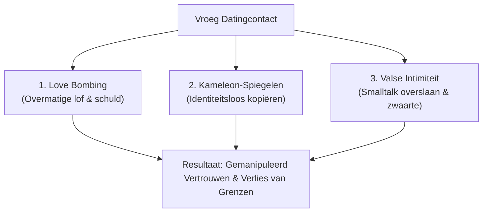

# Manipulatie, kameleon-spiegelen en de illusie van valse intimiteit

> **Kennisbank Integrative Relationship Coaching - Over Daten (Deel 2)**  
> *Hoe manipulatoren in de eerste ontmoetingsfase versneld vertrouwen forceren; de gevaren van love bombing en kameleon-spiegelen; en waarom het overslaan van smalltalk het zenuwstelsel misleidt.*

---

## 1. De mythe van de duidelijke rode vlaggen

In de populaire datingliteratuur wordt manipulatie vaak voorgesteld als iets opvallends en abstracts: een boosaardige narcist die openlijk liegt, kleineert of dramatisch manipuleert. 

In de werkelijkheid van het daten zijn de gevaarlijkste manipulatiepatronen in het begin echter **uiterst zoet, flatterend en bedwelmend**. Ze voelen niet als gevaar; ze voelen als het winnen van de hoofdprijs.

Wie alert wil blijven in de vroege datingfase, kijkt niet naar grove misstappen, maar naar subtiele gedragspatronen waarmee iemand probeert **versneld controle en onverdiend vertrouwen op te bouwen**. 

Wanneer iemand in het eerste contact twee of meer van de volgende drie signalen vertoont, staat het zenuwstelsel terecht op oranje.

---

## 2. De drie signalen ontleed

### Signaal 1: Love bombing (Emotionele schuld creëren)
Iemand overlaadt je direct met intense lofprijzingen, complimenten en buitensporige bewondering. Binnen enkele uren of dagen hoor je dat je *"nog nooit iemand zoals jij bent tegengekomen"*, dat jullie *"soulmates"* zijn, of dat de ander *"nu al niet meer zonder je kan"*.

* **Het psychologische mechanisme:**  
  Dit is geen echte liefde; de ander kent immers nog maar een fractie van jou. Het is een psychologische haak om een **gevoel van emotionele schuld** te vestigen. Wie zoveel lof ontvangt, voelt onbewust de dwingende sociale verplichting om iets terug te geven: begrip, tijd, fysieke intimiteit en loyaliteit. Je wordt afhankelijk gemaakt van zijn of haar goedkeuring.

### Signaal 2: Kameleon-spiegelen (Mirror matching)
De ander blijkt op magische wijze exact dezelfde interesses, favoriete bands, levenswaarden, jeugdtrauma's en toekomstvisies te hebben als jij. Wat jij noemt, vindt de ander *"toevallig ook geweldig"*.

* **Het psychologische mechanisme:**  
  Het menselijk brein ontspant automatisch bij gelijkenis (*in-group bonding*). Manipulatoren gebruiken spiegelen om je kritische waakzaamheid pijlsnel te verlagen. 
* **Het alarmsignaal:**  
  Let op de eigen substantie van de ander. Heeft deze persoon ook eigenzinnige meningen die schuren met de jouwe? Durft iemand te zeggen: *"Nou, daar heb ik helemaal niets mee"*? Wie geen enkele wrijving toont en als een kameleon jouw contouren aanneemt, heeft vaak geen stabiele eigen kernidentiteit.

### Signaal 3: Valse intimiteit fabriceren (Het overslaan van de hechtingsbuffer)
De ander slaat oppervlakkige koetjes en kalfjes demonstratief over (*"Ik hou niet van die oppervlakkige gesprekken, laten we het échte leven induiken"*) en vraagt op de eerste date direct naar je diepste angsten, je grootste relationele wonden of je seksuele trauma's. Of de ander doet zelf direct een reeks zware, emotioneel beladen ontboezemingen.

* **Het psychologische mechanisme:**  
  Ons evolutionaire zoogdierenbrein tuint hier massaal in. Het delen van diepe kwetsbaarheid is evolutionair voorbehouden aan hechte relaties die jaren van betrouwbaarheid hebben bewezen. Wanneer iemand direct zware thema's met ons deelt, concludeert ons limbische brein foutief: *"Omdat we zulke intieme dingen bespreken, moeten we elkaar wel door en door kunnen vertrouwen."*
* Het is een **gefabriceerde intimiteitskick** (*trauma-bonding in de dop*) die de noodzakelijke, langzame opbouw van veiligheid omzeilt.

---

## 3. Waarom smalltalk een levensreddende functie heeft

In veel zelfhulp- en new-agekringen wordt 'smalltalk' neerbuigend weggezet als saai, nietszeggend en oppervlakkig. Dat is een gevaarlijke denkfout.

In gezonde hechtingsprocessen fungeert 'smalltalk' (praten over het weer, je werkdag, een film, de treinreis of wat je lekker vindt om te koken) als een **essentiële biologische hechtingsbuffer**:
* Het geeft het zenuwstelsel de tijd om de ander te 'ruiken', de lichaamstaal te observeren en de stemintonatie te peilen;
* Het stelt beide partners in staat om de micro-reacties van de ander te testen zonder dat er direct iets op het spel staat;
* Het respecteert elkaars privacy en grenzen.

> **Gezond daten heeft een traag tempo.** Echte intimiteit laat zich niet afdwingen in zestig seconden of op de eerste avond; zij groeit organisch naarmate woorden en daden over langere tijd met elkaar in overeenstemming blijken te zijn.

---

## 4. Praktische richtlijnen voor het tempo

1. **Trap op de rem bij overmatig lof:** Ontvang een compliment met een glimlach, maar blijf nuchter: *"Dank je, maar je kent me nog maar net. Laten we eerst maar eens kijken hoe we zijn als we het oneens zijn."*
2. **Kijk naar frictie:** Zoek actief naar de punten waar jullie verschillen. Als alles te perfect naadloos aansluit, is er waarschijnlijk sprake van een projectie of een kameleon.
3. **Bescherm je zwaarte:** Je trauma's, je diepste schaamte en je financiële of relationele wonden zijn kostbare delen van jezelf. Deel ze niet met een wildvreemde op een eerste date. Wie recht heeft op jouw kwetsbaarheid, moet eerst bewijzen dat hij of zij een veilige bedding kan bieden.
