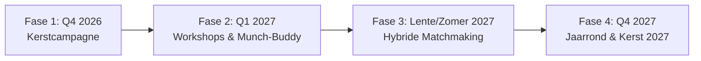

# Organisatie, Fasering & Werkwijze in de Echte Wereld

> **Single Source of Truth (SSOT)** — Document 03  
> *Praktisch organisatiemodel: tijdsinvestering van een halve dag per week, toolstack en meerjarenfasering (2026–2027).*

---

## 1. Tijdsinvestering: Het "Halve Dag per Week" Model

Om het initiatief realistisch, behapbaar en duurzaam te houden naast reguliere werkzaamheden, is de werkwijze ingericht op een vaste tijdsbesteding van **4 uur per week** (bijv. een vaste ochtend of middag):

```
┌────────────────────────────────────────────────────────────────────────┐
│                   VASTE WERKCYCLUS (4 UUR PER WEEK)                    │
├───────────────────┬───────────────────┬────────────────────────────────┤
│ Blok              │ Tijd              │ Activiteit                     │
├───────────────────┼───────────────────┼────────────────────────────────┤
│ 1. Inkomende post │ 45 - 60 minuten   │ Intakeformulieren/vragen       │
│    & Vragen       │                   │ doornemen (Google Forms)       │
├───────────────────┼───────────────────┼────────────────────────────────┤
│ 2. Creatie        │ 90 - 120 minuten  │ Podcast opnemen / audio-edit / │
│    & Productie    │                   │ workshop-content schrijven     │
├───────────────────┼───────────────────┼────────────────────────────────┤
│ 3. Community      │ 45 - 60 minuten   │ Eventvoorbereiding, communicatie│
│    & Afstemming   │                   │ en safe-space moderatie        │
├───────────────────┼───────────────────┼────────────────────────────────┤
│ 4. Rust & Evaluatie│ 15 - 30 minuten  │ Grenzen checken, zelfzorg,     │
│                   │                   │ logboek bijwerken              │
└───────────────────┴───────────────────┴────────────────────────────────┘
```

---

## 2. Eenvoudige, Doeltreffende Toolstack

We houden de technische drempel zo laag mogelijk:
- **Inhoudelijke intake & vragen:** Google Forms (laagdrempelig, anoniem invulbaar, makkelijk te analyseren).
- **Notities & Concepten:** Markdown repository in Git (enkele bron van waarheid).
- **Podcast Hosting & Distributie:** Sinquest platform / Anchor / Spotify for Podcasters.
- **Online Ontmoeting:** Zoom of Discord (met optie voor camera uit en pseudoniemen).
- **Directe Communicatie:** Signal of WhatsApp Community met strikte privacyregels.

---

## 3. Fasering: Van Kerst 2026 naar Jaarrond 2027



### Fase 1: Oktober – December 2026 (Focus op Kerst 2026)
- **Doel:** Zichtbaarheid, herkenning en opvang bieden bij actuele feestdag-eenzaamheid.
- **Projecten:**
  1. *Sinquest (Kinky Kerst Coach) Podcastserie:* 6–8 gerichte afleveringen direct vóór en tijdens kerst.
  2. *Google Intake Vragenlijst:* Verzamelen van anonieme brieven en luisteraarsvragen over eenzaamheid, schaamte en familie.
  3. *Derde Kerstdag Event:* Online "Kerst zonder masker" bijeenkomst op 27 december 2026.

### Fase 2: Januari – Maart 2027 (De Nieuwjaarsstart)
- **Doel:** Van december-isolatie naar duurzame persoonlijke stappen.
- **Projecten:**
  1. *Online Kink-Aware Workshops:* Grenzen, RACK, self-aftercare en de eerste stappen in de scene.
  2. *Munch-Buddy Systeem:* Begeleide eerste bezoeken aan offline munches met een ervaren maatje.

### Fase 3: April – September 2027 (Matchmaking & Verbinding)
- **Doel:** Structurele verbinding faciliteren tussen gelijkgestemden.
- **Projecten:**
  1. *Hybride Matchmaking:* Concept "Twee Groepen, Drie Intenties" (Jongeren 18–30 & Ouderen 50+ / Romantisch, Play, Vriendschap).
  2. *"Kerst in Juli" Zomerbijeenkomst:* Informele picknick of online check-in halverwege het jaar.

### Fase 4: Oktober – December 2027 (Consolidatie & Kerst 2027)
- Evaluatie van het eerste jaar, doorontwikkeling van de podcast en een verankerd netwerk tegen eenzaamheid.
