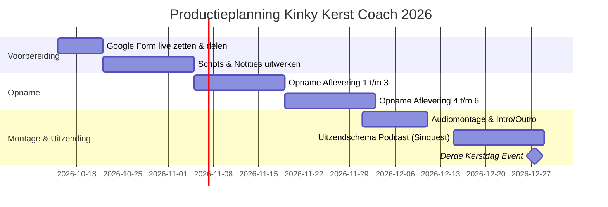

# Productieplanning Kinky Kerst Coach (Najaar 2026)

Dit stappenplan geeft week per week aan wat er moet gebeuren om de serie tijdig en ontspannen af te ronden voor Kerst 2026.

---

## Tijdlijn Overzicht (Oktober – December 2026)

---

## Wekelijks Draaiboek (4 uur per week)

### Week 42 (15 – 21 oktober 2026)
- **Doel:** Intakeformulier lanceren.
- **Acties:**
  - Google Form aanmaken aan de hand van de blauwdruk.
  - Link delen via Sinquest kanalen, sociale media, relevante fora of nieuwsbrief.
  - Vaste opnametijd in de agenda blokkeren (1 vast dagdeel per week).

### Week 43 – 44 (22 oktober – 4 november 2026)
- **Doel:** Inhoudelijke outlines en scripts afronden.
- **Acties:**
  - Eerste binnengekomen formulieren/brieven doornemen en categoriseren.
  - 3 kernbrieven selecteren voor aflevering 1, 2 en 3.
  - Audio-apparatuur (microfoon, opnamesoftware) testen.

### Week 45 – 46 (5 – 18 november 2026)
- **Doel:** Eerste opnameblok (Afl. 1 t/m 3).
- **Acties:**
  - Opnemen Afl 1: *De Kerstkramp & Plastic Emoties*.
  - Opnemen Afl 2: *De Lege Stoel & Single in de Scene*.
  - Opnemen Afl 3: *Het Stille Oordeel & Neurodiversiteit*.
  - Ruwe audio back-uppen.

### Week 47 – 48 (19 november – 2 december 2026)
- **Doel:** Tweede opnameblok (Afl. 4 t/m 6).
- **Acties:**
  - Opnemen Afl 4: *Red Flags & Schijnveiligheid*.
  - Opnemen Afl 5: *Donkere Dagen, Drop & Zelf-Aftercare*.
  - Opnemen Afl 6: *Chosen Family & Kijken naar 2027*.

### Week 49 – 50 (3 – 16 december 2026)
- **Doel:** Montage, mastering en inplannen van publicaties.
- **Acties:**
  - Intro/outro muziek toevoegen, niveaus gelijk trekken.
  - Show notes en linkjes naar hulplijnen (113, Luisterlijn) invoeren.
  - Aankondiging en Zoom/Discord link voor het 'Derde Kerstdag' event klaarzetten.

### Week 51 – 52 (17 – 27 december 2026): De Uitzendweek
- **Doel:** Dagelijkse of twee-dagelijkse release rond de feestdagen.
- **Publicatieschema:**
  - *18 dec:* Release Afl 1 (De Kerstkramp)
  - *20 dec:* Release Afl 2 (De Lege Stoel)
  - *22 dec:* Release Afl 3 (Het Stille Oordeel)
  - *24 dec (Kerstavond):* Release Afl 4 (Red Flags) + Bonus Rustige Meditatie
  - *25 dec (1e Kerstdag):* Release Afl 5 (Drop & Zelf-Aftercare)
  - *26 dec (2e Kerstdag):* Release Afl 6 (Chosen Family) + reminder voor Derde Kerstdag
  - *27 dec:* **Live Online Event: "Kerst zonder Masker"** (14:00 – 16:30)
