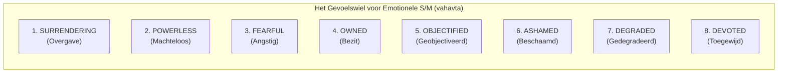

# Emotionele S/M en het gevoelswiel voor submissieven

> **Centrale Source of Truth (SSOT) - Document 14 in de Kennisbank BDSM & Kink-Aware Theorie**  
> *Over de psychologische architectuur van psychologisch sadomasochisme, de erotisering van taboe-emoties (schaamte, degradatie, machteloosheid) en het in kaart brengen van de innerlijke belevingswereld van de onderdaan.*

---

## 1. Wat is emotionele S/M?

In de publieke beeldvorming wordt sadomasochisme (S/M) bijna altijd gereduceerd tot fysieke prikkels: zwepen, touw, klemmen, wasknijpers of sensorische deprivatie. In de doorleefde praktijk van BDSM vormt het fysieke lichaam echter vaak slechts de klankkast. De werkelijke intensiteit speelt zich af op het niveau van **emotionele en psychologische S/M**.

Emotionele S/M is de bewuste, consensuele uitwisseling van macht waarbij niet het vlees, maar de innerlijke belevingswereld, het zelfbeeld en de affectieve toestand van de submissieve partner centraal staan.

```
┌─────────────────────────────────────────────────────────────────┐
│                 FYSIEK VERSUS EMOTIONEEL S/M                    │
├───────────────────────────────┬─────────────────────────────────┤
│          FYSIEK S/M           │         EMOTIONEEL S/M          │
├───────────────────────────────┼─────────────────────────────────┤
│ • Prikkel: slagen, touw, pijn │ • Prikkel: blik, toon, oordeel  │
│ • Zone: huid, spieren, zenuwen│ • Zone: zelfbeeld, hechting, eer│
│ • Herstel: uren tot dagen     │ • Herstel: vraagt diepe aarding │
│ • Risico: kneuzing, striemen  │ • Risico: zelftwijfel, drop     │
└───────────────────────────────┴─────────────────────────────────┘
```

Waar fysieke striemen binnen enkele dagen wegtrekken, raakt emotionele S/M direct aan vroege hechtingservaringen, schaamte, trots, existentiële angst en het verlangen naar radicale overgave. Dit maakt emotionele S/M potentieel oneindig veel bevrijdender, maar tegelijkertijd aanzienlijk risicovoller voor het psychologische evenwicht dan louter fysiek spelen.

Het vormt de ultieme toepassing van de [Techniek-Betekenis Splitsing (Document 02)](02-techniek-versus-betekenis.md): de fysieke handeling doet er nauwelijks toe; het draait volledig om wat het zenuwstelsel beleeft in de betekenislaag.

---

## 2. Het Gevoelswiel voor Emotionele S/M

Om de complexe emotionele ladingen van onderdanen inzichtelijk en bespreekbaar te maken, ontwikkelde maker **vahavta** het *Feeling Wheel for Emotional S/M* `[Bron / exacte herkomst nog te verifiëren door auteur: 'Feeling Wheel for Emotional S/M' door vahavta]`. 

Geïnspireerd door klassieke emotiewielen uit de psychologie, ordent dit model de subjectieve ervaring van de submissieve in **acht emotionele kernpolen** (de binnenste ring), die elk uitwaaieren naar specifieke sub-gevoelens en nuances (de buitenste ring).



---

## 3. De acht belevingspolen ontleed: het licht-donker spectrum

De acht belevingspolen op het wiel zijn niet gelijk van aard of intensiteit. Ze bewegen zich over een fundamentele **Licht-Donker As**. 

* **Het Lichte Spectrum (Hechting, Zorgeloosheid & Verheffing):** Prikkels die het zenuwstelsel voeden met verbinding, vrome adoratie, gekoesterde afhankelijkheid en de rust van niet meer hoeven sturen. Het zenuwstelsel rust in een mengvorm van ventraal vagaal (veilige hechting) en ontspannen overgave.
* **Het Donkere Spectrum (Schaduw, Ontluistering & Catharsis):** Prikkels die afdalen naar wat psycholoog Carl Gustav Jung de existentiële schaduw noemde. Het bewust opzoeken van morele taboes, inferioriteit, walging, angst en vernedering. Hier wordt het sympathische zenuwstelsel gealarmeerd of het dorsaal vagale systeem geprikkeld, maar binnen een bewaakte container met consent.
* **De Scharnierpolen (Bi-polair):** Categorieën die afhankelijk van de intonatie, intentie en context zowel uiterst licht en koesterend als diep donker en ontluisterend kunnen worden beleefd.

```
┌─────────────────────────────────────────────────────────────────────────────────┐
│                     DE LICHT-DONKER AS VAN EMOTIONELE S/M                       │
├─────────────────────┬────────────────────────┬──────────────────────────────────┤
│ SPECTRUM            │ BELEVINGSCATEGORIE     │ EMOTIONELE EN SOMATISCHE LADING  │
├─────────────────────┼────────────────────────┼──────────────────────────────────┤
│ ☀️ PUUR LICHT       │ 8. Devoted             │ Verheffing, adoratie, extase,    │
│                     │                        │ transcendentale vroomheid        │
├─────────────────────┼────────────────────────┼──────────────────────────────────┤
│ ☀️ HECHTEND LICHT   │ 4. Owned               │ Veiligheid, claim, bescherming,  │
│                     │                        │ ontlasting van het volwassen ego │
├─────────────────────┼────────────────────────┼──────────────────────────────────┤
│ ☀️ DIENSTBAAR LICHT │ 1. Surrendering        │ Vrijwillige overgave, toewijding,│
│                     │                        │ het neerleggen van de wapens     │
├─────────────────────┼────────────────────────┼──────────────────────────────────┤
│ ⚖️ SCHARNIERPOOL    │ 5. Objectified         │ Nuttig/waardevol (☀️ licht) vs.  │
│                     │                        │ ontmenselijkt/nutteloos (🌑 donker)│
├─────────────────────┼────────────────────────┼──────────────────────────────────┤
│ ⚖️ SCHARNIERPOOL    │ 2. Powerless           │ Kwetsbaar open (☀️ licht) vs.    │
│                     │                        │ gebroken/gecorrumpeerd (🌑 donker)│
├─────────────────────┼────────────────────────┼──────────────────────────────────┤
│ 🌑 SCHADUW (ALARM)  │ 3. Fearful             │ Sympathische piek, doodsangst,   │
│                     │                        │ adrenaline als contrastvloeistof │
├─────────────────────┼────────────────────────┼──────────────────────────────────┤
│ 🌑 SCHADUW (TABOE)  │ 6. Ashamed             │ Erotisering van falen, gêne en   │
│                     │                        │ sociale blootstelling            │
├─────────────────────┼────────────────────────┼──────────────────────────────────┤
│ 🌑 DIEPE SCHADUW    │ 7. Degraded            │ De absolute bodem: walging,      │
│                     │                        │ kleinheid en inferioriteit       │
└─────────────────────┴────────────────────────┴──────────────────────────────────┘
```

Hieronder volgt de gedetailleerde ontleding van de acht polen, gerangschikt van licht naar donker, inclusief de specifieke sub-gevoelens.

---

### 1. Devoted (Toegewijd / Devoot) - [Puur licht spectrum]
De meest verheven en spirituele pool van het wiel. Hier transformeert de onderwerping in vrome adoratie en aanbidding. Het zenuwstelsel ervaart diepe vervoering doordat het eigen kleine ego oplost in dienstbaarheid aan iets dat als heilig of groots wordt ervaren.
* **Reverent (Eerbiedig / Vol ontzag):** *[☀️ Licht]* De ander zien als groots, soeverein en onaantastbaar;
* **Enraptured (Verrukt / In vervoering):** *[☀️ Licht]* De extatische, transcendente roes van het mogen dienen;
* **Desperate-for (Hunkerend naar):** *[☀️ Licht tot intens]* Een smachtend verlangen naar een woord, aanraking of blik van goedkeuring;
* **Obsessed (Geobsedeerd):** *[☀️ Licht met fixatie]* Volledige mentale focus op de wensen en het welzijn van de Dominant;
* **Dependent (Afhankelijk):** *[☀️ Licht / Hechting]* Het vrijwillig en met vertrouwen overdragen van de regie over het eigen welzijn en genot.

### 2. Owned (Eigendom / Bezit zijn) - [Hechtend licht spectrum]
De fundamentele hechtingspool binnen D/s. Eigendom zijn biedt een diepe psychologische rust: het ontslaat de onderdaan van de existentiële eenzaamheid van het zelfstandige volwassen bestaan. *"Omdat ik van jou ben, draag jij de verantwoordelijkheid."*
* **Protected (Beschermd):** *[☀️ Puur licht]* De veilige haven: omdat ik bezit ben, zorgt mijn eigenaar voor mij. Niemand anders mag mij raken;
* **Claimed (Opgeëist / Geclaimd):** *[☀️ Puur licht]* Het vervullende gevoel gemarkeerd, gewild en onvoorwaardelijk toegeëigend te zijn;
* **Bound-to (Gebonden aan):** *[☀️ Licht / Verbinding]* Het warme besef van onverbrekelijke loyaliteit en toewijding aan deze specifieke meester of vrouwe;
* **Controlled (Gecontroleerd / Beheerst):** *[☀️ Licht met strakke kaders]* Elk detail van houding, kleding of adem wordt gereguleerd, wat rust brengt in een overprikkeld brein.

### 3. Surrendering (Overgave) - [Dienstbaar licht spectrum]
Het actieve en vrijwillige besluit om de wapens en de controle neer te leggen. Waar machteloosheid passief kan voelen, is overgave een bewuste relationele gift: de onderdaan schenkt de regie aan de ander.
* **Submissive (Onderdanig):** *[☀️ Licht]* De innerlijke kalmte en bereidheid om te volgen, te buigen en te luisteren;
* **Obedient (Gehoorzaam):** *[☀️ Licht]* De voldoening van het punctueel en foutloos uitvoeren van bevelen, protocollen en taken;
* **Sacrificial (Opofferend):** *[☀️ Licht met overgave]* Het gevoel jezelf weg te schenken ter meerdere eer en glorie van de partner of het ritueel;
* **Helpless (Hulpeloos):** *[⚖️ Overgang naar schaduw]* De overgave bereikt de grens waar de onderdaan somatisch beseft zelf echt niets meer te kunnen uitrichten.

### 4. Objectified (Geobjectiveerd) - [Scharnierpool: Waarde versus Ontmenselijking]
Deze pool toont haarscherp hoe dezelfde categorie twee volkomen tegenovergestelde ladingen kan dragen, afhankelijk van de intentie:
* **Valuable (Waardevol):** *[☀️ Lichte modus]* Een kostbaar, gekoesterd bezit zijn dat gepoetst en bewonderd wordt als een fijn kunstwerk of sieraad;
* **Useful (Nuttig):** *[☀️ Lichte modus]* De trotse voldoening van een vlekkeloos functionerend instrument zijn dat exact doet waarvoor het ontworpen is;
* **Inspected (Geïnspecteerd / Gekeurd):** *[⚖️ Neutrale overgangszone]* Het kille, afstandelijke gevoel van nauwgezet onderzocht worden op fouten, houding, reinheid of gehoorzaamheid;
* **Dehumanized (Ontmenselijkt):** *[🌑 Donkere schaduwmodus]* Behandeld worden als een zielloos ding, een meubelstuk, pop, asbak of voetveeg;
* **Useless (Nutteloos):** *[🌑 Donkere schaduwmodus]* Gereduceerd worden tot iets dat geen enkele praktische waarde heeft; overtollige ballast die louter getolereerd wordt.

### 5. Powerless (Machteloosheid) - [Scharnierpool: Kwetsbaarheid versus Schaduw]
Het wegvallen van handelingsbekwaamheid. Dit beweegt van zachte, ontwapende openheid naar de rauwe confrontatie met overmacht en verlies van autonomie.
* **Vulnerable (Kwetsbaar):** *[☀️ Lichte modus]* Volledig openliggen, ontdaan van het sociale pantser, in een staat van zachte, ontvankelijke puurheid;
* **Overpowered (Overmeesterd):** *[⚖️ Neutraal / Fysieke overmacht]* De directe somatische sensatie dat de ander fysiek of mentaal domweg veel te sterk, groot en gezaghebbend is;
* **Broken (Gebroken):** *[🌑 Donkere schaduwmodus]* Het kraken van de eigen weerstand, trots of koppigheid; het moment waarop de wil definitief capituleert;
* **Corrupted (Gecorrumpeerd / Bedorven):** *[🌑 Diepe schaduw]* Het intense gevoel dat je morele kaders, maagdelijkheid of fatsoensnormen zijn aangetast; je bent ingewijd in een 'verdorven' realiteit.

### 6. Fearful (Bevreesd / Angstig) - [Donker spectrum: Sympathische piek & Alarm]
Hier wordt het zenuwstelsel doelbewust in een alarmtoestand gebracht. Angst fungeert in BDSM als een genadeloze versneller van het hier-en-nu: wie bang is, piekert niet meer over het dagelijks leven. Het is de contrastvloeistof voor de latere opluchting.
* **Anxious (Ongerust / Zenuwachtig):** *[🌑 Schaduw]* De knagende anticipatiespanning; het wachten op de eerste slag of het naderende vonnis;
* **Dread-filled (Beklemd / Vol vrees):** *[🌑 Schaduw]* Het zware, donkere voorgevoel van een onafwendbare, zware beproeving;
* **Panicked (In paniek):** *[🌑 Donkere piek]* De kortstondige biologische piek waarin het zenuwstelsel balanceert op de rand van de *window of tolerance*;
* **Terrified (Doodsbang):** *[🌑 Extreme schaduw]* Het rauwe oeralarm dat, mits binnen een absoluut veilige container gehouden, omslaat in een vloedgolf van endorfines en overgave.

### 7. Ashamed (Beschaamd) - [Donker spectrum: Erotisering van Taboe & Gêne]
Schaamte is een van de meest sociaal pijnlijke en isolerende emoties. In BDSM wordt schaamte geërotiseerd en gelouterd: wat normaal verborgen moet blijven uit angst voor verstoting, wordt nu juist in het felle schijnwerperlicht getrokken.
* **Embarrassed (In verlegenheid gebracht):** *[⚖️ Lichte schaduw / Speels]* Blozen, ongemak en stunteligheid die liefdevol of streng geobserveerd worden;
* **Exposed (Blootgesteld):** *[🌑 Schaduw]* Fysiek, seksueel of psychologisch volkomen ontbloot voor het observerende oog van de ander;
* **Humiliated (Vernederd):** *[🌑 Schaduw]* De knieval maken; jezelf kleiner weten dan de ander en die minderwaardigheid publiekelijk of ritueel moeten belichamen;
* **Bullied (Gepest / Geïntimideerd):** *[🌑 Diepe schaduw]* Het speelse of genadeloze treiteren dat de sociale superioriteit van de Dominant en de hulpeloosheid van de onderdaan onderstreept.

### 8. Degraded (Gedegradeerd) - [Diep-donker spectrum: De Psychologische Bodem]
De meest compromisloze schaduwpool van het wiel. Waar schaamte gaat over sociaal falen, gaat degradatie over het actieve verlies van status, waardigheid en menselijke verhevenheid. Dit is de duik naar de absolute bodem, waar het ego niets meer overeind kan houden.
* **Small (Klein):** *[🌑 Donker]* Gereduceerd tot een nietig, onbetekenend wezentje aan de voeten van de meester of vrouwe;
* **Inferior (Minderwaardig):** *[🌑 Donker]* Van lagere rang, stand of morele categorie zijn;
* **Pathetic (Meelijwekkend / Pathetisch):** *[🌑 Diepe schaduw]* Het pijnlijke maar ontwapenende besef hoe jammerlijk, zwak en hulpeloos je overkomt;
* **Unworthy (Onwaardig):** *[🌑 Diepe schaduw]* Het gevoel dat je de aandacht, gunst of tijd van de Dominant eigenlijk niet eens verdient;
* **Disgusting (Walgelijk):** *[🌑 Diepste schaduw]* Vies gevonden worden, spuug ontvangen, het gevoel hebben onrein te zijn en daar desalniettemin in aanvaard of gebruikt worden.

---

## 4. De psychologie van emotioneel masochisme: waarom verlangen mensen hiernaar?

Voor buitenstaanders en beginnende beoefenaars roepen labels als *disgusting*, *broken*, *useless* of *terrified* vaak afschuw op. Waarom zou een mentaal gezond, autonoom mens er in hemelsnaam naar verlangen om zich 'waardeloos' of 'gepest' te voelen?

De psychologische verklaring berust op drie peilers:

### A. De ontlading van het autonome volwassen ego
In het dagelijks leven dragen moderne mensen een loodzware verantwoordelijkheid: succesvol zijn op het werk, een gezin draaiende houden, moreel zuiver handelen en rationeel functioneren (zie ook [het Tweelagenmodel in de Kennisbank](../over-relaties/relatietheorieen/01-het-tweelagenmodel-in-relatiedynamieken.md)). 

Emotionele S/M biedt een **radicale vakantie van het ego**. Door 'waardeloos', 'klein' of 'eigendom' te worden gemaakt, vervalt in één klap de eis tot prestatie en controle. Je hoeft niets meer te bewijzen; je bent al op de bodem. Die val naar beneden brengt een diepe somatische ontspanning teweeg.

### B. Erotisering en loutering van oude hechtingswonden
Veel mensen dragen impliciete schaamte mee uit hun jeugd (gepest zijn, emotionele verwaarlozing, religieuze dogma's over zonde en reinheid). In het gewone leven leidt schaamte tot krampachtige isolatie. 

Binnen een veilige BDSM-container gebeurt het wonderlijke: de afkeuring of vernedering wordt **opgevoerd als een ritueel spel met expliciet consent**. Het gevreesde oordeel (*"jij bent walgelijk"* of *"jij stelt niets voor"*) leidt nu niet tot verlating of fysiek gevaar, maar mondt uit in intense erotische verbinding, aandacht en zorgzame aftercare. Het zenuwstelsel herschrijft de oude associatie: *wat vroeger isoleerde, verbindt nu.*

### C. Het contrastmechanisme van het zenuwstelsel
Net zoals een hete sauna het ijsbad erna intenser maakt, fungeert emotionele vernedering of angst als contrastvloeistof voor de latere opname in liefdevolle geborgenheid (*aftercare*). Hoe dieper de submissieve afdaalt in 'machteloosheid' of 'vernedering', hoe transcendenter en verlossender de uiteindelijke aanvaarding voelt.

---

## 5. De dynamiek van licht en donker in een sessie

Het wiel laat zien dat een BDSM-ervaring zelden statisch op één plek blijft. De werkelijke alchemie van emotionele S/M ontstaat door het **bewust bewegen over de licht-donker as**:

1. **De afdaling in de schaduw (donker):** Een scène kan openen met strenge begrenzende controle, oplopende anticipatie-angst (*Fearful: Dread-filled*) of verbale ontluistering (*Ashamed: Exposed* en *Degraded: Small*). Hier wordt het trotse volwassen ego doelbewust ontmanteld en de controle gebroken;
2. **De kentering via de scharnierpolen:** Via gerichte functionele inzet (*Objectified: Useful*) of het toelaten van de eigen ontwapende kwetsbaarheid (*Powerless: Vulnerable*) kantelt het verweer van de onderdaan om in actieve overgave;
3. **De opname in het licht (verheffing & geborgenheid):** De ontlading culmineert in overgave (*Surrendering: Submissive*) en landt uiteindelijk in pure devotie, bezit en bescherming (*Owned: Protected* en *Devoted: Enraptured*).

Juist dit contrastmechanisme maakt de beleving zo transformerend voor het zenuwstelsel: de diepte van de doorgemaakte schaduw bepaalt de helderheid en de verlossing van het licht bij de landing.

---

## 6. Risico's en de anatomie van de emotionele drop

Het onderschatten van emotionele S/M leidt tot de zwaarste vormen van **Subdrop** en **Domdrop** (zie [Document 03: Neurochemie, Drop & Aftercare](03-neurochemie-drop-en-aftercare.md)).

### Waarom emotionele drop gevaarlijker is dan fysieke drop:
1. **Onzichtbaarheid:** Fysieke vermoeidheid of spierpijn is tastbaar. Een emotionele kras (een nare smaak over vernederende woorden) sluipt geruisloos naar binnen en openbaart zich pas na 24 tot 48 uur als eenzaamheid, zelfhaat of relationele vervreemding;
2. **De grens tussen spel en realiteit vervaagt:** Als een Dominant zegt: *"Je bent een waardeloos stuk vuil"*, kan het subcorticale brein (het Zelf) vergeten dat dit een rol binnen een scène was, zeker wanneer de aarding na afloop tekortschiet;
3. **Domdrop door schuldgevoel:** Een Dominant die een onderdaan emotioneel heeft gebroken of vernederd, kan de volgende dag overspoeld worden door intense schuld en twijfel: *"Wat voor monster ben ik eigenlijk dat ik dit tegen iemand zeg van wie ik hou?"*

### Richtlijnen voor aftercare bij emotionele S/M:
* **Expliciete re-humanisering:** Haal de onderdaan direct na afloop uit de rol. Spreek de persoon aan bij zijn/haar eigen voornaam;
* **Spiegelen van waarde:** Benoem expliciet dat de gehoorzaamheid, de overgave en de getoonde kwetsbaarheid dapper en diep gewaardeerd waren;
* **Fysieke ontprikkeling:** Warme dekens, suikers, oogcontact en een rustige stem om het zenuwstelsel terug te loodsen naar de ventraal vagale toestand van veiligheid;
* **De 48-uurs check-in:** Plan altijd een kort contactmoment op dag twee om te polsen of er geen residu van schaamte of zelfverwijt is blijven hangen.

---

## 7. Praktische toepassing: de emotionele traffic light

In intakegesprekken en pre-scene onderhandelingen kan het Gevoelswiel worden gebruikt als een diagnostisch instrument. In plaats van te vragen: *"Mag ik je slaan?"*, leg je het wiel voor en vraagt:

1. **Groen:** Welke emotionele polen wil je zenuwstelsel graag ervaren? (Bijv. *Devoted*, *Owned*, *Protected*);
2. **Oranje:** Welke polen schuren, dagen uit, maar zijn met zorgvuldige dosering welkom? (Bijv. *Exposed*, *Overpowered*, *Humiliated*);
3. **Rood (Hard limits):** Welke gevoelens mogen absoluut **niet** worden geactiveerd omdat ze traumatische lading dragen? (Bijv. *Bullied*, *Corrupted* of *Disgusting*).

Door de onderhandeling op het niveau van emoties te voeren, wordt BDSM getransformeerd van een platte reeks technieken naar een diepzinnig, helend en betekenisvol psychologisch ambacht.

> **Cruciale Verdieping — De Twee Spiegels:**  
> Het Gevoelswiel voor de submissieve kan niet in een relationeel vacuüm functioneren. Wanneer een Dominant louter fungeert als uitvoerder van de behoeften van de sub, ontstaat 'dienstbare schijndominantie' (*topping from the bottom*). Zie [Document 15: Het Spiegelwiel voor Dominanten, de Dynamische Boog en Veiligheidskaders](15-emotionele-sm-het-spiegelwiel-voor-dominanten-en-de-dynamische-boog.md) voor de acht dominante holding-polen, het voorkomen van Domdrop en de co-emergente dynamiek tussen beide lenzen.

---

## 8. Verbindingen binnen de kennisbank

* [02: De Techniek-Betekenis Splitsing](02-techniek-versus-betekenis.md) - *De theoretische basis voor het onderscheid tussen fysieke handeling en emotionele betekenis.*
* [03: Neurochemie, Drop & Aftercare](03-neurochemie-drop-en-aftercare.md) - *Biochemische mechanismen achter endorfinepieken en de post-scene landing.*
* [07: Subspace versus Freeze](07-subspace-versus-freeze.md) - *Polyvagaal onderscheid tussen gezonde overgave en traumatische dissociatie.*
* [08: BDSM als Co-Creatie: De Twee Driehoeken](08-bdsm-als-cocreatie-de-twee-driehoeken.md) - *Overgave en ontferming als relationeel fundament.*
* [15: Emotionele S/M: Het Spiegelwiel voor Dominanten & De Dynamische Boog](15-emotionele-sm-het-spiegelwiel-voor-dominanten-en-de-dynamische-boog.md) - *De complementaire binnenwereld van de Dominant, de acht spiegelpolen, de Techniek-Betekenis koppeling en het 4-fasen boogmodel.*
* [De Emotie-Verdubbelaar en Affectlogica](../over-emoties/de-emotie-verdubbelaar-en-affectlogica.md) - *Hoe secundaire schaamte en schuld het zenuwstelsel gijzelen.*

