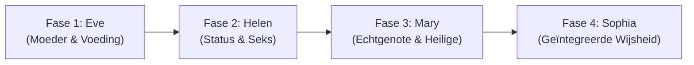

# De vier vrouwen van een man: de ontwikkelingsfasen van de anima

> **Theoretisch kader & ontwikkelingspsychologie voor mannen**  
> *Over de vier archetypische vrouwen waar een man in zijn leven voor valt; hoe zij zijn eigen innerlijke rijpingsproces weerspiegelen; en waarom je een vrouw pas werkelijk kunt beminnen als je haar niet meer 'nodig' hebt.*

---

## Inleiding: wie zoekt een man als hij liefheeft?

In mijn coachingspraktijk zie ik regelmatig mannen die wanhopig worstelen met hun partnerkeuze of met het steeds herhalen van dezelfde teleurstellende relatiepatronen:
* De man die zijn vrouw ongemerkt heeft gedegradeerd tot een tweede moeder die zijn was doet en zijn agenda beheert;
* De man die verslaafd is aan de kick van een bloedmooie trofeevrouw om zijn wankele status te stutten, maar leeg achterblijft zodra de buitenkant gewoontjes wordt;
* Of de man die gevangen zit in de klassieke *Madonna-hoer-splitsing*: een brave, devote echtgenote thuis koesteren, terwijl zijn erotische fantasieën uitsluitend gevoed worden door onbereikbare sirenes.

Wat veel mannen niet doorzien, is dat de vrouw op wie zij vallen in werkelijkheid een spiegel is van hun **eigen innerlijke psychologische rijpingsfase**. 

De Zwitserse psychiater Carl Gustav Jung beschreef dit diepgaand in zijn theorie over de **Anima**: het innerlijke vrouwelijke archetype in het onbewuste van de man. Een man projecteert zijn anima op de vrouwen die hij ontmoet. De fase waarin zijn eigen volwassenwording zich bevindt, dicteert welk type vrouw hem magnetisch aantrekt.

---

## De vier ontwikkelingsfasen ontleed

### Fase 1: Eve (De biologische moeder)
* **Psychologische lading:** Instinctieve verzorging, voeding en basale biologische hechting.
* **De dynamiek:** Dit is de eerste liefde van de jongen. Zolang een man in deze fase blijft hangen, zoekt hij in een partner geen gelijke, maar een surrogaatmoeder. Hij wil verzorgd, getroost en opgevangen worden. De partner beheert zijn leven, ruimt zijn emotionele en praktische rommel op en sust zijn angsten.
* **Het mankement:** De relatie is gebaseerd op een kinderlijk **'nodig hebben'** in plaats van een volwassen **'willen'**. Zodra een man zijn partner als moeder beleeft, sterft de erotische polariteit onherroepelijk af: met je moeder ga je immers niet naar bed.

### Fase 2: Helen (De esthetische trofee)
* **Psychologische lading:** Schoonheid, seksuele verovering, romantiek en maatschappelijke status.
* **De dynamiek:** Geïnspireerd op Helena van Troje. De man beweegt van 'nodig hebben' naar 'willen' - op zichzelf een stap voorwaarts in autonomie. Hij zoekt nu een vrouw om mee te pronken: de beeldschone verschijning op Instagram, de knappe vriendin die zijn vrienden jaloers maakt. Zij fungeert als zijn uithangbord en ego-stut.
* **Het mankement:** Deze relaties zijn intens en vurig, maar existentieel leeg. De man ziet niet wie zij werkelijk is; hij ziet slechts een projectiescherm voor zijn eigen statusbehoefte en seksuele lust. Zodra de esthetische glans slijt of er echte kwetsbaarheid wordt gevraagd, haakt hij teleurgesteld af.

### Fase 3: Mary (De deugdzame echtgenote)
* **Psychologische lading:** Loyaliteit, morele zuiverheid, toewijding en moederschap voor zijn kinderen.
* **De dynamiek:** Geïnspireerd op de Maagd Maria. De man verlangt naar rust, een stabiel gezin en een deugdzame levenspartner. Hij aanbidt haar toewijding en haar rol als moeder. 
* **Het mankement:** Hier voltrekt zich de pijnlijke psychologische splitsing. De man adoreert haar als 'heilige' en als moeder van zijn nageslacht, maar ontseksualiseert haar daardoor. Hij zoekt een echtgenote en een instituut, geen volbloed vrouw met eigen schaduwkanten en rauwe verlangens. In zijn hoofd blijft het verlangen naar Helen (de ontembare minnares) spoken, wat leidt tot geheime porno-consumptie, emotionele vervreemding of ontrouw.

### Fase 4: Sophia (Geïntegreerde wijsheid en gelijkwaardigheid)
* **Psychologische lading:** Wijsheid, innerlijke compleetheid, spirituele en emotionele integratie.
* **De dynamiek:** Sophia (het Griekse woord voor wijsheid) is geen vrouw die een man extern op straat of via een datingapp vindt. Zij ontstaat op het moment dat de man **stopt met projecteren**. 

Een man kan pas een Sophia ontmoeten wanneer hij de zorgende moeder, het erotische vuur en de morele goedheid **in zichzelf** heeft opgebouwd. Hij heeft zijn eigen fundament gelegd: hij kan voor zichzelf zorgen, draagt zijn eigen eenzaamheid en stut zijn eigen status.

Doordat hij haar niet meer krampachtig 'nodig' heeft om een innerlijk tekort te dempen, hoeft zij geen rol meer voor hem te spelen:
* Zij hoeft geen moeder voor hem te zijn;
* Zij hoeft geen trofee te zijn om zijn ego op te vijzelen;
* Zij hoeft geen heilige maagd te zijn om hem gerust te stellen.

Zij mag simpelweg zijn wie ze is: een soeverein mens met licht en donker. Zij wordt gezien als zijn gelijke, zijn geliefde, zijn beste vriend en zijn partner. 

---

## De relationele paradox van volwassenheid

Hier ligt een van de mooiste wetmatigheden in de relationele psychologie:

> **Pas wanneer een man een vrouw niet meer nodig heeft om zichzelf compleet te voelen, is hij in staat om werkelijk van haar te houden.**

Zolang er een behoefte aan Eve, Helen of Mary onder de relatie ligt, is liefde altijd een verkapte handelstransactie (*"jij vult mijn leegte, dus ben ik loyaal aan jou"*). Pas in de integratie van Sophia ontstaat werkelijke vrijheid: twee hele mensen die elkaar niet claimen uit armoede, maar elkaar ontmoeten in overvloed.

